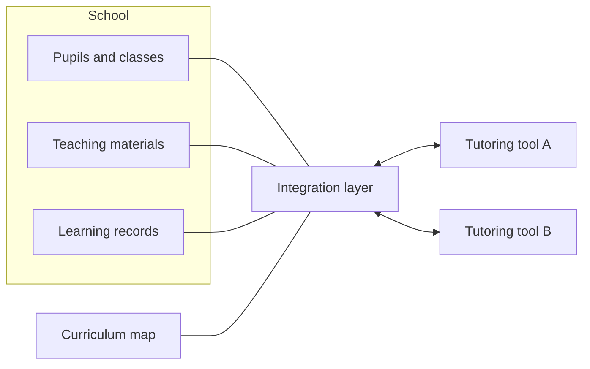

# How it works: the big picture

{: .in-short }
Schools' systems on one side, tutoring tools on the other, and an integration layer in the middle that links everything to one curriculum map.

## The pieces

- **The school's own systems**: its list of pupils and classes, its teaching materials, and a store for learning records.
- **The shared curriculum map**: every unit and lesson, and which come before which.
- **The integration layer**: the system in the middle, between schools and AI tutoring tools.
- **The tutoring tools**: they ask for context and send back what happened.

## How information flows

1. **Before a session**, a tool asks the integration layer for classroom context: where the lesson sits, the school's materials for it, and what's known about the pupil.
2. **During the session**, the tool sends each answer the pupil gives.
3. **At the end**, the tool sends a record of the session and its report on what the pupil understood.
4. **Afterwards**, the integration layer updates the pupil's summary, and matches any unlabelled materials to their lesson.

## Where the data lives

- **Answers** are kept in a standard learning record store, so a real one could be used later.
- **Sessions, reports and summaries** are kept in a store of the integration layer's own.
- **Pupils, classes and materials** stay in the school's systems. The integration layer only asks for them when it needs them.
