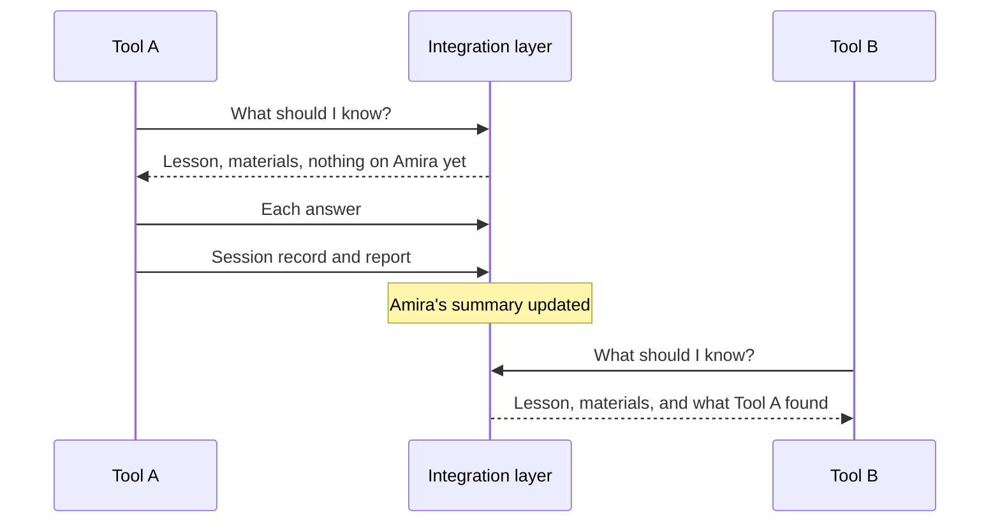

# One pupil's journey

{: .in-short }
A story of one Year 9 pupil, two tutoring tools and a teacher's quiz, showing the whole system at work.

The pupil and the school are made up.

## A new pupil

Amira is in Year 9. Her class is starting a science unit on the carbon cycle.
She hasn't used a tutoring tool before, so nothing is known yet about how she learns.

## Tool A asks what it should know

Before the session, Tool A asks the integration layer for classroom context.
In one request it gets:

- the lesson her class is on, and what comes before and after it,
- the school's materials for that lesson,
- what's known about Amira so far, which is nothing yet.

## The teacher's quiz

Her teacher has uploaded a quiz they wrote themselves. Nobody labelled it.
In the background, the integration layer described the quiz and matched it to the right lesson.
So Tool A can use the teacher's own quiz, not just its own questions.

## Amira learns with Tool A

Tool A sends each answer Amira gives as she goes.
At the end of the session, it sends a short report: she understands how carbon moves between living things, but mixes up photosynthesis and respiration.

The integration layer updates Amira's summary for the unit.

## Tool B picks up where Tool A left off

Later in the week, Amira uses Tool B for homework.
When Tool B asks for classroom context, it's told what Tool A found.
So it starts with photosynthesis and respiration, instead of going over what she already knows.

