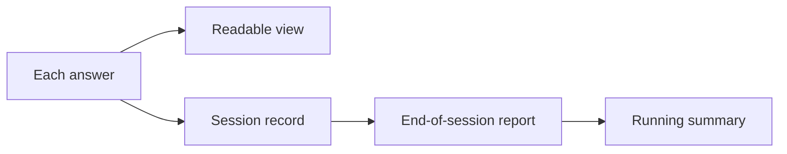

# The records

{: .in-short }
Five kinds of record, from each answer a pupil gives to a running summary of how well they understand a topic.

## The five records

1. **Each answer.**
   Every answer a pupil gives is saved as a standard learning record (xAPI), in a learning record store.
   It says who answered, which question, what they said, and whether it was right.
2. **A readable view of each answer.**
   This isn't stored. It's worked out from the answer when someone asks for it, adding things like the lesson the question belongs to.
3. **One record per session.**
   When a session ends, the tool says which unit it covered and which materials it used.
4. **The tool's end-of-session report.**
   The tool's judgement of what the pupil understood in that session, and any misconceptions it spotted.
5. **A running summary.**
   One per pupil per unit, built from all the reports so far.
   This is what the next tool reads to know where the pupil is.

## The rules

- **Facts are kept apart from judgements.**
  Answers and sessions are facts. Reports and summaries are judgements, and can be redone without touching the facts.
- **Records are never edited.**
  A correction is added as a new version, so anything built from a record can always say what it was built from.
- **Every record says who wrote it** and which version of the curriculum map it used.

## How the records relate

